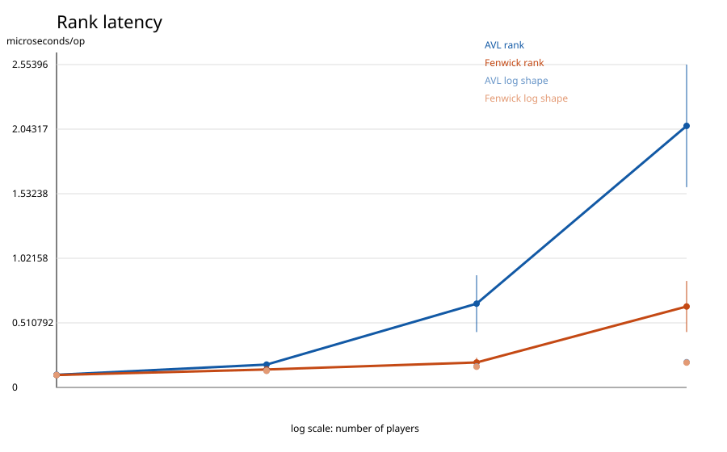
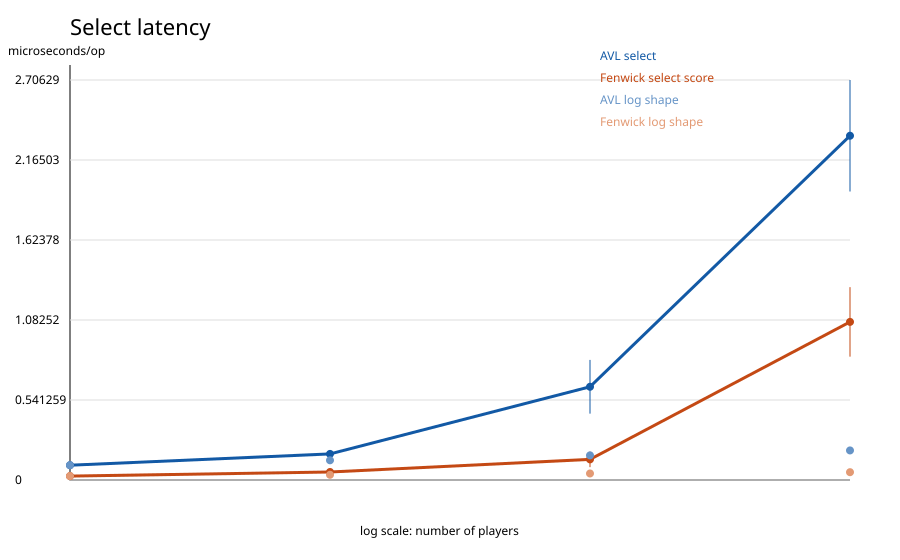
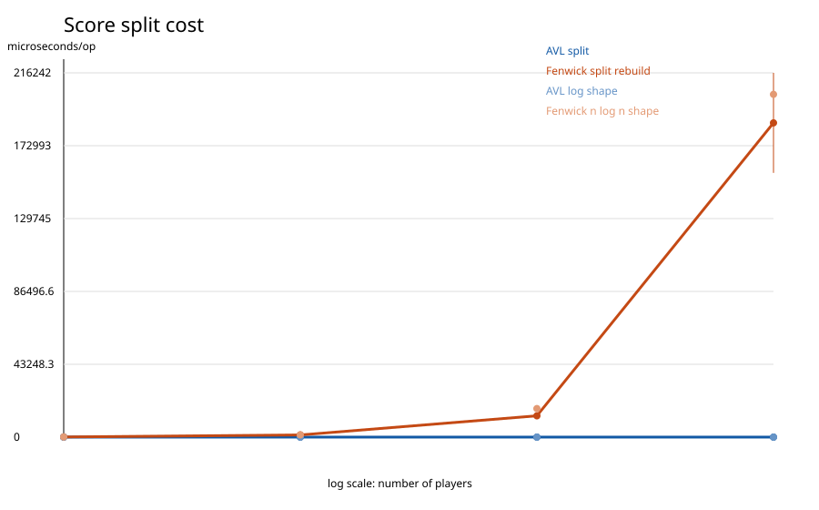
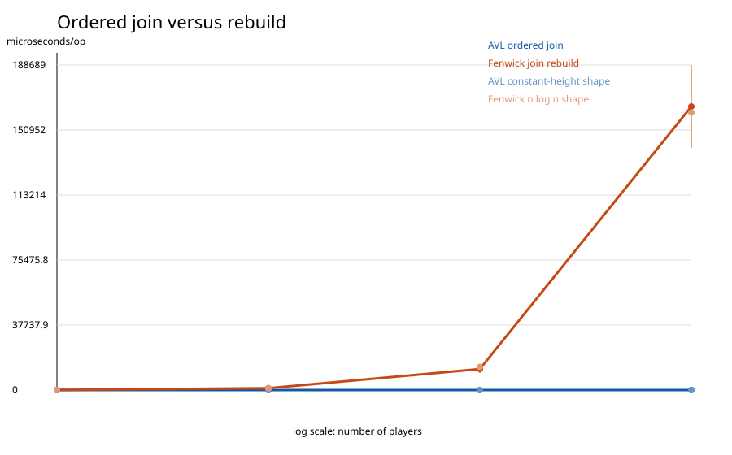

# Project 2: Rank Queries on a Live Leaderboard

Team Big_O(6) - design, correctness, and measurement report. Measurements below were collected on 2026-11-21. The predicted model was committed earlier in [0f3543f](https://github.com/Champei/Rank-queries-on-a-live-leaderboard/commit/0f3543f); the raw measurements are in `results/raw/full.csv`.

## 1. Team and contributions

| Member | Roll no. | Main contribution | Pull request |
|---|---|---|---|
| Chaitanya Sharma | 250001020 | Augmented AVL, ordered join and split, D1 | [#4](https://github.com/Champei/Rank-queries-on-a-live-leaderboard/pull/4) |
| Teerth Dudhagara | 250001027 | Coordinate-compressed Fenwick and D2 | [#1](https://github.com/Champei/Rank-queries-on-a-live-leaderboard/pull/1) |
| Prathamesh Hingol | 250001056 | Shared interface, open-addressing hash, application, D3 | [#9](https://github.com/Champei/Rank-queries-on-a-live-leaderboard/pull/9), [#13](https://github.com/Champei/Rank-queries-on-a-live-leaderboard/pull/13) |
| Herin Patel | 250001033 | Sorted-array oracle, differential runner, D4 | [#10](https://github.com/Champei/Rank-queries-on-a-live-leaderboard/pull/10) |
| Jay Gupta | 250001035 | Adversarial generators, audits, D5 | [#11](https://github.com/Champei/Rank-queries-on-a-live-leaderboard/pull/11) |
| Sarthak Pandey | 250001063 | Cost model, benchmark harness, plotter, D6 | [#12](https://github.com/Champei/Rank-queries-on-a-live-leaderboard/pull/12) |

These links identify the module contributions in repository history. The measurements and this expanded report are later integration work and should be attributed by their eventual commit.

## 2. Problem

A game holds up to one million players while scores change. A player needs a competition rank, which gives tied scores the same rank, and the service must list exact leaderboard positions such as 40 through 50. Season operations divide players at a score threshold and combine regional leagues. Position order requires a second rule within ties; we put the smaller player ID first. The application also needs a way to find a player's old score before a revision, so it keeps an independent hash table.

The two structures serve different strengths. An AVL tree stores complete `(score, ID)` entries in order, making positions and ordered structural split/join possible. A Fenwick tree stores counts over a known score universe, making rank and score selection array-based, but it cannot name the player at a selected position and must rebuild on a change of coordinates or division. The application keeps both representations synchronized so that their ranks agree.

## 3. Interface and invariants

`INTERFACE.md` and `include/leaderboard.hpp` define the contract. Scores and IDs use `ll` (`long long`); positions are one-based. The AVL orders larger scores first and smaller IDs first within a tie. Every AVL node stores the correct subtree count and height, has a balance factor in `[-1,1]`, and respects strict pair-key ordering. `Avl::audit()` checks those properties recursively. The Fenwick tree stores nonnegative score counts; its `bit` array agrees with those counts and its total matches the player count. `Fenwick::audit()` checks them.

`Leaderboard::audit()` checks that the AVL, Fenwick, and player hash have equal populations and agree on each stored entry. `revise(id,score)` replaces an old entry in all three structures, or inserts a new player. `remove` deletes from all three. `split(threshold)` consumes the source and returns scores above the threshold and scores at or below it. `merge(other)` consumes a league with disjoint IDs and a compatible score universe.

## 4. Structure A: augmented AVL

Each node stores an `Entry`, two child links, height, and subtree count. The pair comparator orders by descending score and ascending ID. Insert and delete rebalance the search path with single or double rotations. Link changes are followed by bottom-up height and count repair, so rank and selection can skip entire subtrees. Each update takes `O(log n)` time; the checker detects a stale size even when ordinary search still appears correct.

`rank(score)` counts only entries with a strictly larger score, then adds one. `select(position)` descends using the left-subtree count to find an exact pair; both cost `O(log n)`. `rank_range(first,last)` prunes irrelevant subtrees and emits `k` entries in `O(log n + k)` time. It rejects positions below one and reversed ranges; a range beginning past the end is empty.

The internal ordered join descends the taller tree's boundary spine until the remaining subtree heights fit around the pivot. It rebalances on the return path. With valid ordered inputs, the internal work is `O(|h1-h2|+1)`. The public `Avl::join` also scans boundary keys to reject overlap before moving ownership; this makes its complete cost `O(log n)`. Structural split partitions around a pair key by joining the path pieces and costs `O(log n)`. `split_score` divides on a score threshold. Arbitrary regional leagues need not be in disjoint pair-key ranges, so application merge inserts entries individually instead of calling ordered join.

We chose explicit height and count fields rather than recomputing subtree sizes during queries. The latter would turn selection into a scan. We chose an AVL instead of a library ordered container because subtree metadata, rotation audit, and split/join are the subject of this project.

## 5. Structure B: compressed Fenwick tree

The score universe is sorted and deduplicated before replay. Arrays store a count for each coordinate and Fenwick partial sums; updates move through Fenwick parents in `O(log U)`, where `U` is the number of allowed scores. If `P(s)` counts scores at or below `s`, competition rank is `1 + total - P(s)`. Binary lifting finds the first ascending prefix whose count reaches the converted target for descending selection. Both take `O(log U)`.

The tree stores score counts, not IDs; `select_score` returns a score, while the AVL returns a specific player. Its coordinate set is fixed. Inserting an unseen score requires reconstruction with a wider universe. Division and combination build new count arrays from player scores, taking `O(n log U)` in this implementation. We retained the ordinary contiguous-array Fenwick representation instead of adding a dynamic coordinate tree, because the rebuild exposes the intended contrast with structural AVL split/join.

## 6. Requirement beyond the lecture

The beyond-lecture operation is ordered AVL join and split. Blelloch, Ferizovic, and Sun's sequential join idea descends the taller tree until a pivot can connect subtrees with compatible heights, then repairs balance while returning. Our `Avl::join_nodes` follows that height-guided structure and maintains both height and subtree count. `Avl::split_node` rebuilds the two path sides through joins. Unlike the abstract operation, the public implementation validates the complete ordering precondition before taking ownership, adding a boundary-search cost. D1 and D5 give the proof for the internal join and telescoping split; their exact project statements are in the supplied project description.

## 7. Correctness and bug log

`oracle/reference.cpp` keeps a sorted vector with its own pair comparator. It performs simple searches and scans, so it does not depend on AVL or Fenwick metadata. `oracle/differential.cpp` compares each revision or removal against that reference, samples rank and selection, periodically checks ranges and invariants, and compares every final position and rank. Targeted cases cover empty state, missing and negative IDs, ties, repeated updates, invalid positions, and split/merge. A failing random trace is reduced by deleting chunks.

On 2026-11-21, MSYS2 GCC 16.2.0 built the integrated code. `bash tests/run_tests.sh` passed 1,000,000 differential operations with seed 253 and ID pool 1,000, focused hash and application assertions, CSV behavior, and adversarial AVL checks at 100, 1,000, and 10,000 nodes. The separate application replay with 1,000,000 players and 1,000,000 revisions completed, printed positions 40 through 50, split into 499,336 and 500,664 players at score 5,000, and merged back to 1,000,000; its output is in ignored `build/full_replay.txt` when `scripts/run_all.sh` runs.

| Date | Module | Symptom | Found by | Fix commit |
|---|---|---|---|---|
| 2026-11-14 | Oracle | A shared exception handler could hide a mismatch when removing a missing ID from the implementation and reference. | Review of missing-ID differential case | [e54f401](https://github.com/Champei/Rank-queries-on-a-live-leaderboard/commit/e54f401) |

The row above reflects the correction recorded in `TOOLS.md` and the independent exception checks now present in `oracle/differential.cpp`. Do not add hypothetical or planted faults to this real-bug log.

## 8. Adversarial inputs

`adversary/generators.cpp` creates sorted insertions, deletion orders, tied keys, and joins with unequal tree heights. `adversary/check.cpp` audits the full tree after each operation, checks order and selection, and tests boundary rejection without losing input trees. Sorted insertion of `n` successive new extreme keys causes exactly `n - bitlen(n)` single rotations in the tested sequence. The fraction tends to one as `n` grows; D5 supplies the argument. One constructed delete order also produced almost one rotation per delete, which is a measured observation rather than a general theorem.

| n | Insert rotations | Constructed delete rotations | One-end delete rotations |
|---:|---:|---:|---:|
| 100 | 93 | 93 | 44 |
| 1,000 | 990 | 990 | 491 |
| 10,000 | 9,986 | 9,986 | 4,988 |

These are from the 2026-11-21 checker run with the documented size arguments. Random join/split checks in the same run use seed 253. Full-tree audits are deliberately expensive and are not included in the latency benchmark.

## 9. Predicted cost model, committed before measurement

The original prediction was added in [0f3543f](https://github.com/Champei/Rank-queries-on-a-live-leaderboard/commit/0f3543f) on 2026-11-15, before the 2026-11-21 raw data. Let `n` be live players, `U` distinct possible scores, `m` entries in a merged league, and `k` returned range entries. AVL rank and select: approximately `a0 + a1 log2(n)` due to pointer-based descent. Fenwick rank and binary-lifting selection: approximately `b0 + b1 log2(U)` with contiguous arrays. The coefficients were not fixed from later measurements. AVL range extraction is `O(log n + k)`; internal AVL split is `O(log n)`, and ordered join is `O(|h1-h2|+1)` before public boundary validation. Fenwick division and combination rebuild counts in `O(n log U)` here. Arbitrary application merge inserts individually in `O(m log(n+m))` for AVL work plus Fenwick updates.

The prediction was that Fenwick rank/select would often gain from array locality when `U` is near `n`, but not necessarily win every case. Isolated AVL split should become much cheaper than rebuilding Fenwick counts as `n` grows. Full application split also rebuilds hash and Fenwick state, so it cannot inherit the isolated AVL bound.

## 10. Experimental setup

- Date: 2026-11-21, Asia/Calcutta.
- Machine: Intel Core Ultra 5 125H, 18 logical processors, Windows build 10.0.26300. RAM and cache sizes could not be read under the current account and need to be filled from the machine specifications before final submission.
- Compiler: MSYS2 MinGW-w64 GCC 16.2.0, C++17, `-O2 -Wall -Wextra -Wpedantic`.
- Harness: `bench/benchmark.cpp`, `std::chrono::steady_clock`, five trials per point, seed 253, sizes 1,000, 10,000, 100,000, and 1,000,000. Rank/select trials use 100,000 queries each in full mode. AVL split and ordered join trials average 1,000 repetitions; Fenwick rebuilds are timed once per trial. The score universe contains `n` distinct scores and starts with one player at each score.
- Raw data: `results/raw/full.csv`, with each trial, mean, and sample standard deviation. Figure generator: `bench/plot.cpp`.

Timing was not isolated from other processes. No cache-miss profiler was run, so differences cannot be attributed to a measured cache effect.

## 11. Results and model comparison

All entries are five-trial mean microseconds per operation. The raw CSV contains standard deviations and individual trials. Dashed curves in the figures show the precommitted asymptotic shapes, scaled to each measured series at `n=1,000` only to put shape and measurements on the same axes. That scale is a post-measurement visual anchor, not an independently predicted latency or a fitted coefficient.

| Operation | n=1,000 | n=10,000 | n=100,000 | n=1,000,000 |
|---|---:|---:|---:|---:|
| AVL rank | 0.100 | 0.181 | 0.663 | 2.069 |
| Fenwick rank | 0.098 | 0.142 | 0.198 | 0.640 |
| AVL select entry | 0.100 | 0.176 | 0.631 | 2.329 |
| Fenwick select score | 0.026 | 0.054 | 0.140 | 1.070 |
| AVL score split | 0.704 | 0.938 | 1.125 | 2.564 |
| Fenwick split rebuild | 101.740 | 1,303.300 | 12,669.200 | 186,554.000 |
| AVL ordered join | 0.097 | 0.113 | 0.115 | 0.200 |
| Fenwick join rebuild | 80.560 | 1,085.340 | 12,205.100 | 164,618.000 |

*Figure 1. Rank time in microseconds per operation against player count on a log-scaled horizontal axis. Generated by `bench/plot.cpp` from `results/raw/full.csv`; bars show one sample standard deviation and dashed lines show anchored logarithmic model shapes. Both structures increase with size, with Fenwick lower at one million players.*

*Figure 2. Selection time in microseconds per operation against log-scaled player count. Generated by `bench/plot.cpp` from `results/raw/full.csv`; bars show one sample standard deviation and dashed lines show anchored logarithmic model shapes. AVL returns a player entry while Fenwick returns only a score.*

*Figure 3. Isolated score split versus two Fenwick rebuilds, in microseconds per operation against log-scaled player count. Generated by `bench/plot.cpp` from `results/raw/full.csv`; bars show one sample standard deviation, with dashed logarithmic and `n log n` shapes respectively. The large rebuild values compress the AVL series on this linear vertical scale.*

*Figure 4. Ordered AVL join versus a Fenwick count rebuild, in microseconds per operation against log-scaled player count. Generated by `bench/plot.cpp` from `results/raw/full.csv`; bars show one sample standard deviation and dashed constant-height-gap and `n log n` shapes. AVL join here has compatible ordered halves; application merge has broader inputs and different cost.*

The direction of all four series families agrees with the asymptotic model: tree/array queries grow slowly relative to full count reconstruction. The rank means at one million players are 2.069 us for AVL and 0.640 us for Fenwick; the selection means are 2.329 us for an AVL entry and 1.070 us for a Fenwick score. These measured growth factors are larger than a simple `log2(n)` ratio from 1,000 to one million, so a fixed-coefficient logarithmic curve is not an accurate numerical fit. The model describes operation counts, not a calibrated latency predictor; memory behavior, allocator state, and system noise are plausible factors, but were not profiled.

The isolated AVL split mean rises from 0.704 to 2.564 us, while rebuilding the two Fenwick partitions rises from 102 to 186,554 us. Ordered AVL join remains around 0.10-0.20 us because the tested halves have similar heights; the `|h1-h2|+1` model predicts little height-gap work in that case. Fenwick join rebuild rises from 81 to 164,618 us. At one million players the standard deviations were 0.485 us for AVL rank, 0.202 us for Fenwick rank, 0.219 us for AVL split, and 29,688 us for Fenwick split rebuild; this spread limits fine-grained claims. The model did not provide numerical coefficients, so the dashed curves show anchored trends rather than absolute preregistered latency predictions.

## 12. Limitations and next measurements

The Fenwick universe is fixed per instance; unseen scores require a rebuild. Public AVL join scans boundary spines to check its precondition, so an isolated internal `O(|h1-h2|+1)` claim is not the complete public-call cost. Application split reconstructs hash and Fenwick state, and application merge handles overlapping score ranges by individual insertion. The benchmark compares AVL entry selection with Fenwick score selection and isolated structural operations with count rebuilds; those are useful cost contrasts but not identical end-to-end requests.

Before the final tag, obtain RAM/cache specifications, run a profiler if making a cache claim, time the complete application split and merge, and verify the instructor's hidden-test input/output format. Repeat the full run on a quiet machine to assess variance. Do not replace the committed pre-measurement prediction with fitted coefficients.

## 13. References

1. G. M. Adelson-Velsky and E. M. Landis, “An algorithm for the organization of information,” *Soviet Mathematics Doklady* 3:1259-1263, 1962.
2. P. M. Fenwick, “A new data structure for cumulative frequency tables,” *Software: Practice and Experience* 24(3):327-336, 1994.
3. G. E. Blelloch, D. Ferizovic, and Y. Sun, “Just join for parallel ordered sets,” SPAA 2016, arXiv:1602.02120. The relevant part here is the sequential AVL join.
4. R. E. Tarjan, *Data Structures and Network Algorithms*, SIAM, 1983, Chapter 4.
5. T. H. Cormen, C. E. Leiserson, R. L. Rivest, and C. Stein, *Introduction to Algorithms*, 3rd ed., MIT Press, 2009, sections 14.1-14.2.
6. D. E. Knuth, *The Art of Computer Programming*, Vol. 3, 2nd ed., Addison-Wesley, 1998, section 6.2.3.
7. `INTERFACE.md`, `TOOLS.md`, `docs/derivations/`, and `results/raw/full.csv` in this repository; the supplied Project 2 description and submission guidelines.
